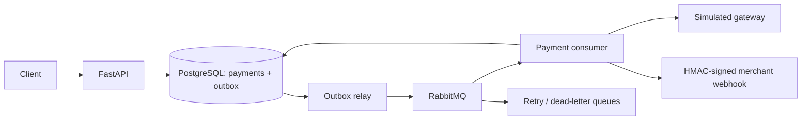

# Paystream — asynchronous payment processing

[](https://github.com/Gegirhasut/paystream/actions/workflows/ci.yml)

**A payment-service reference implementation with a transactional outbox, idempotent
processing and signed merchant webhooks.** FastAPI accepts a payment request;
background workers process it through a **simulated gateway** and notify a demo
merchant. No real payment processor is connected.

**Stack:** Python, FastAPI, Pydantic v2, SQLAlchemy 2 async, PostgreSQL,
RabbitMQ/FastStream, Alembic, Docker Compose and pytest.

[Detailed Russian documentation](README.ru.md) preserves the full API examples,
retry demonstrations, configuration and original design discussion.

## Architecture and engineering decisions



- **Persist before publishing.** Payment and outbox records commit together.
  The relay marks an event published only after broker confirmation, closing the
  database/broker dual-write gap. Delivery remains at-least-once.
- **Handle duplicates at multiple boundaries.** An `Idempotency-Key` plus a request
  fingerprint replays the original payment or rejects a conflicting request.
  Row locks serialize consumer processing; finalized payments skip the gateway.
  If a charge outcome is uncertain, the payment stays `pending` and safe retry
  depends on the gateway honoring the payment ID as its idempotency key.
- **Separate charge and notification transactions.** A webhook failure does not
  roll back a recorded payment result. Webhooks can be redelivered after an
  ambiguous failure; merchants must deduplicate by payment ID.
- **Bound failures and recover stalled work.** Retry queues and a dead-letter queue
  handle repeated failures; recovery scans unfinished payments and a watchdog
  detects a lost consumer subscription.
- **Keep monetary values exact.** Amounts use decimal arithmetic and
  PostgreSQL `NUMERIC(18, 2)`, rather than binary floating point.
- **Constrain webhook egress.** HMAC-SHA256 signs timestamp and body. The sender
  validates destination addresses and pins the checked IP; redirects and environment
  proxies are disabled. Internal destinations require an explicit allowlist.

Read the [payment processor](app/services/processor.py),
[outbox relay](app/outbox_relay/relay.py),
[recovery](app/outbox_relay/recovery.py) and
[webhook egress checks](app/services/egress.py).

## Run locally

Requires Docker and Docker Compose v2. Default host ports are `8000`, `5432`,
`5672`, `15672` and `8080`; adjust the environment if they are occupied.

```bash
git clone https://github.com/Gegirhasut/paystream.git
cd paystream
cp .env.example .env
docker compose up -d --build
```

Migrations run on startup. API documentation is at <http://localhost:8000/docs>;
the health endpoint is <http://localhost:8000/health>.

```bash
curl -X POST http://localhost:8000/api/v1/payments \
  -H "X-API-Key: change-me" -H "Idempotency-Key: first-payment" \
  -H "Content-Type: application/json" \
  -d '{"amount":"100.00","currency":"USD","webhook_url":"http://webhook-receiver:8080/webhooks"}'
```

`change-me` is the local demo API key, not a production credential.

| Endpoint | Behavior |
|---|---|
| `POST /api/v1/payments` | Returns `202` with a payment ID; identical retries replay the original payment; conflicting reuse of a key returns `409`. |
| `GET /api/v1/payments/{payment_id}` | Returns `pending`, `succeeded` or `failed`, with timestamps. |
| `GET /health` | Public health check; API-key authentication applies to `/api/v1/*`. |

The demo merchant at <http://localhost:8080/webhooks> records received callbacks.
Its `/webhooks/flaky` and `/webhooks/fail` endpoints exercise retries and dead-lettering.
See [the full walkthrough](README.ru.md) for examples and environment variables.

## Validation

The [verified CI run](https://github.com/Gegirhasut/paystream/actions/runs/38683774498)
at commit `5b09c20` reports **195 passing tests** against real PostgreSQL and
RabbitMQ in Docker, alongside lint checks. This is a result for that revision,
not a promise that every future revision passes.

```bash
make test
make lint
```

Tests use a separate database and RabbitMQ vhost. Coverage includes idempotent
requests, outbox recovery, duplicate delivery, gateway failures, webhook signing,
egress validation and broker failure handling.

## Scope and trade-offs

This is an engineering demonstration, not a live payment service. It has one
client configuration, shared API/webhook secrets and a simulated gateway.
Network calls hold database row locks, which simplifies ordering but consumes
connections while requests are in flight. A higher-throughput design would need
an explicit processing state and a different coordination strategy.

Before production use, add operational metrics, dead-letter alerts and replay
tooling, provider-specific integration and reconciliation, and deployment-specific
access controls. Health checks and API documentation are unauthenticated locally.
